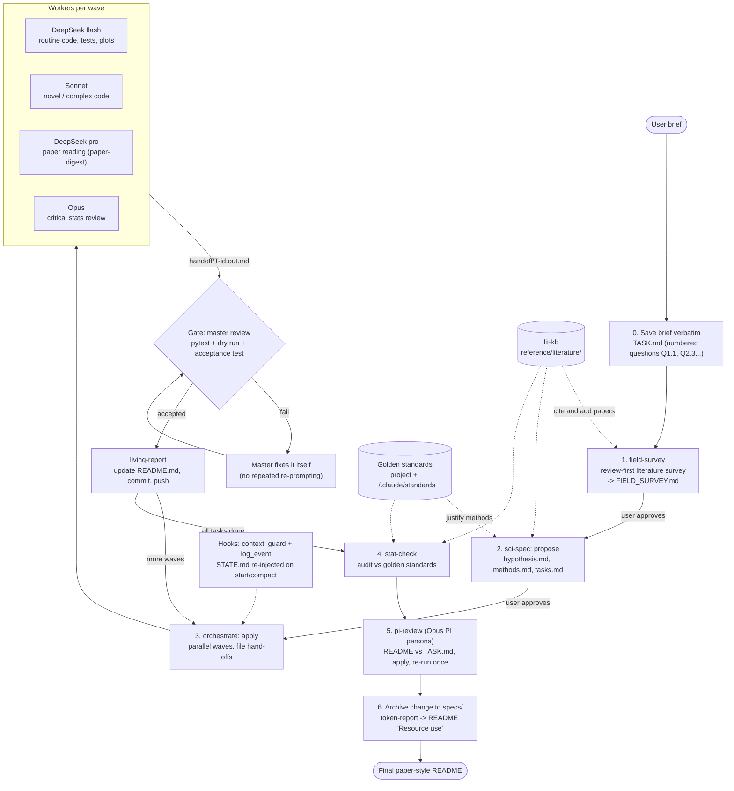

# claude-env

Portable Claude Code setup: global `CLAUDE.md`, settings, skills, agents, tools (DeepSeek + Claude API delegates),
hooks, standards, memory. **Secrets are NOT in this repo.**
Restore on a new device: clone to `~/.claude`, then `bash ~/.claude/bootstrap.sh`.

---

## 1. The idea in one paragraph

A scientific project is run as a **spec-driven, multi-model pipeline**. The *master* (Claude Code, the model you chat with)
plans, decides methods, integrates and talks to you. Cheap models write routine code, strong models review the statistics,
and a long-context model reads papers. Every hand-off goes through **files** (not chat), every method choice must be
justified by a **literature-based standard**, and results are written to a **living README** that a biologist can read first.

## 2. Workflow at a glance



## 3. Who does what

### 3.1 Agents / models (who)

| Actor | How it is called | Does | Does NOT do |
|---|---|---|---|
| **Master** (Claude Code session) | you chat with it | Plan, method options, integration, review of every delegate output, README, talking to you | Bulk coding (delegated), unapproved costly runs |
| **DeepSeek flash** | `tools/deepseek_delegate.py --standard` (API script) | Routine code: boilerplate, transforms, plots, simple tests, refactors | Method decisions, novel logic |
| **DeepSeek pro** (1M context) | `deepseek_delegate.py --model pro` via `paper-digest` | Reads long papers, returns summaries with page-cited rules and exact quotes | Anything unverified: its quoted numbers are grepped against the source |
| **Sonnet** | `tools/claude_delegate.py --model sonnet --standard` (API script) | New or complex task-specific code; review of DeepSeek output | Stats judgement |
| **Opus** | `claude_delegate.py --model opus --effort high` | Critical stats/method second opinion; PI review of the README | Routine work (costly) |
| **Subagent `scientific-reasoning`** | Agent tool, manual only | Opus-level reasoning that needs repo/tool access | Auto-invocation |
| **Subagent `pi-reviewer`** | Agent tool | PI-style README vs TASK.md review (read-only tools) | Editing files |
| **Subagent `data-processing`** | Agent tool, manual only | Simple cleaning / reformatting with project context (Haiku) | Stats judgement; stops and reports if ambiguous |

Note: "API script" delegates are plain API calls from scripts (budget-guarded, ledgered in `state/`), not Agent-tool subagents.
The master checks that the served model equals the requested one and treats truncated replies as failures.

### 3.2 Skills (what, and when)

| Stage | Skill | Purpose | Main output |
|---|---|---|---|
| Start | `field-survey` | Review-first survey, parallel readers, "Enough Test" instead of paper count | `reference/golden_standard/FIELD_SURVEY.md` |
| Start | `lit-kb` | Per-project citable literature base; search BEFORE answering science questions, add AFTER using a paper | `reference/literature/` (INDEX, BibTeX, notes) |
| Start | `paper-digest` | Offloads paper reading to DeepSeek pro with quote verification | `SUMMARY.md` beside each source |
| Design | `sci-spec` | propose -> spec -> tasks -> apply -> archive | `changes/<name>/{hypothesis,methods,tasks}.md` |
| Build | `orchestrate` | Runs `tasks.md` in parallel waves with model routing | `changes/<name>/handoff/T<id>.out.md` |
| Build | `code-standard` | One coding/testing preamble for every agent; review checklist | consistent, tested code |
| Verify | `stat-check` | Audits a finished run against the standards | list of flagged problems |
| Report | `living-report` | README as a living, paper-style report | `README.md` (pushed after each wave) |
| Finish | `pi-review` | Senior-PI persona (Opus) checks README against TASK.md | `PI_review.md`, applied edits |
| Finish | `token-report` | Tokens by API / model / problem type | `figures/token_usage.png` |

### 3.3 Tools, hooks, standards

| Item | Location | Role |
|---|---|---|
| `deepseek_delegate.py` | `tools/` | DeepSeek flash/pro calls; prints a `[deepseek_usage]` line |
| `claude_delegate.py` | `tools/` | Sonnet/Opus API calls with budget guard; prints a `[claude_usage]` trailer |
| `ds_triage.py` | `tools/` | Bulk DeepSeek triage of literature for surveys |
| `context_guard.py` | `hooks/` | Warns at ~120K tokens, asks for checkpoint at ~180K; snapshots `STATE.md` before compaction; re-injects it on start/resume |
| `log_event.py` | `hooks/` | Logs each task (calls, tokens, delegate verification status) to `<project>/.claude/logs/` |
| `general_principles.md` | `standards/` | General methodological standard; project ones live in `reference/golden_standard/` |
| `STATE.md` template | `templates/` | <=60-line project memory: goal, decisions, current step, next action |

## 4. Step by step

1. **Brief -> `TASK.md`.** Your request is saved verbatim with numbered questions. It is re-read at every milestone.
2. **Field survey.** Master runs `field-survey`; parallel readers (DeepSeek pro via `paper-digest`) summarize papers; papers cited by 3 or more sources are must-reads; stop when the Enough Test passes. You approve `FIELD_SURVEY.md`.
3. **Spec.** `sci-spec` produces hypothesis, a methods options table (science and efficiency pros/cons, recommendation, default if you say nothing) and a task graph with an owner model per task. You approve. If standards are silent or conflict, the master asks you rather than improvising.
4. **Apply.** `orchestrate` launches independent tasks in parallel. Each worker gets paths, an acceptance test and the code standard, writes a <=10-line hand-off file, and returns only "done".
5. **Gate.** Master runs `pytest`, a **dry run** on a tiny subset, and checks the acceptance test. Verdict per delegate output: accepted / fixed / rejected. Failures are fixed by the master, not re-prompted.
6. **Big runs.** After "dry run passed", the master tells you an estimated runtime and asks. Long jobs use all cores, log to `logs/<job>.log` (`tail -f`), and are monitored for stalls.
7. **Report.** After every wave `living-report` updates the README, which is committed and pushed. Chat only gives a one-line result.
8. **Audit and review.** `stat-check`, then Opus-based `pi-review` against `TASK.md`; apply its edits and re-run once.
9. **Close.** Archive the change to `specs/`, add the token-usage figure, and deliver a README that answers every numbered question.

## 5. Standing rules (from `CLAUDE.md`)

- Git: small reversible commits, commit before risky changes, never commit secrets or large data; ask before new remotes, force-push or history rewrites.
- Ask first for anything costly, irreversible or external-facing; a passed dry run is not approval.
- Max 2-3 fix attempts on an error, then stop and summarize.
- Messages start with one bold line (decision or status plus default pick); method names get a one-line gloss.
- README leads with answers for a biologist: task, what was built, findings with numbers, meaning and non-meaning, trust level, then methods.

## 6. Repo layout

```
CLAUDE.md        global conventions          settings.json   permissions + hooks
agents/          subagent definitions        skills/         workflow skills (section 3.2)
tools/           DeepSeek / Claude delegates hooks/          context guard + event log
standards/       general methodology         templates/      STATE.md
projects/*/memory  persistent memory         bootstrap.sh    restore on a new Mac
```
