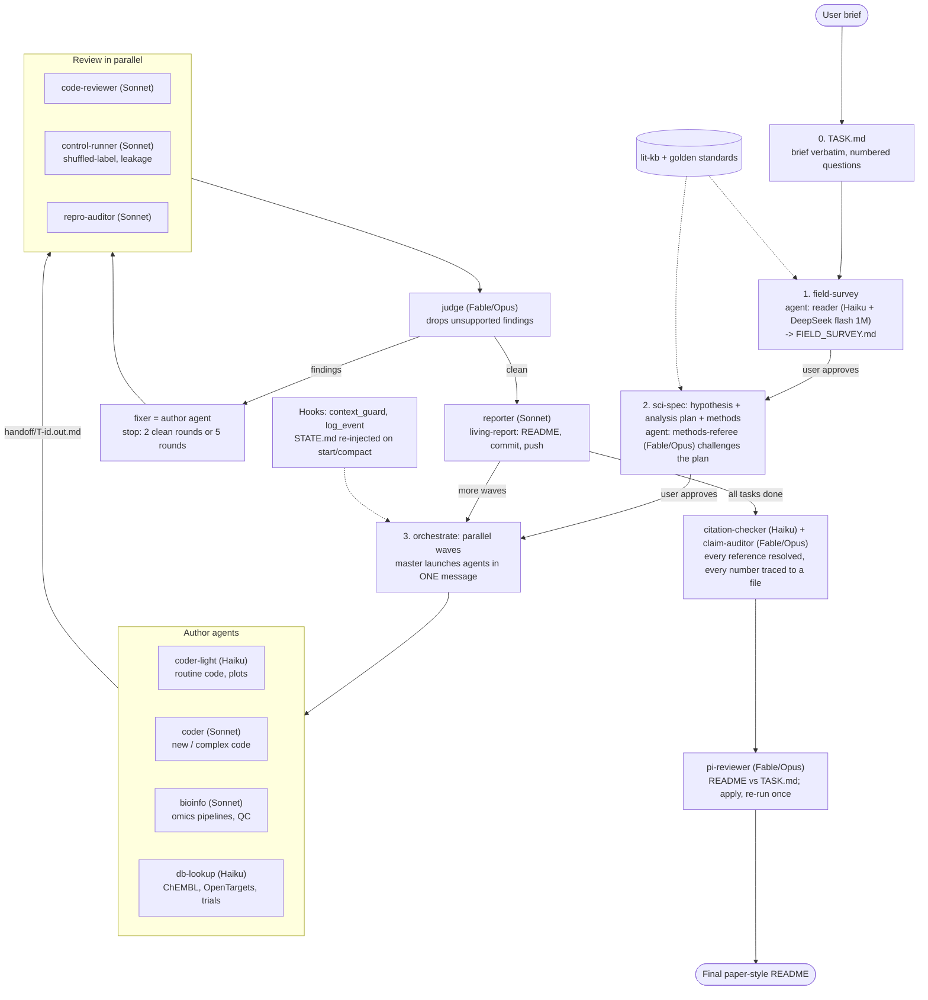

# claude-env

Portable Claude Code setup: global `CLAUDE.md`, settings, skills, agents, tools (DeepSeek + Claude API delegates),
hooks, standards, memory. **Secrets are NOT in this repo.**
Restore on a new device: clone to `~/.claude`, then `bash ~/.claude/bootstrap.sh`.

---

## 1. The idea in one paragraph

A scientific project is run as a **spec-driven, multi-model pipeline**. The *master* (Claude Code, the model you chat with)
plans, decides methods, integrates and talks to you. Cheap models write routine code, strong models review the statistics,
and a long-context model reads papers. Every hand-off goes through **files** (not chat), every method choice must be
justified by a **literature-based standard**, and results are written to a **living README** that a biologist can read first.

## 2. Workflow at a glance



## 3. Who does what

The master (the Claude Code session you talk to) plans, chooses methods, integrates, and talks to you. It never reads papers, code or logs itself;
it receives a result of at most 10 lines plus file paths from each agent. Agents start with an empty context and cannot spawn other agents.

### 3.1 Agents (`agents/`)

| Agent | Model | Preloaded skills | Does |
|---|---|---|---|
| `reader` | Haiku driver + DeepSeek flash 1M | paper-digest, field-survey, lit-kb | Reads papers/long docs; page-cited digests; quotes verified by grep |
| `citation-checker` | Haiku | lit-kb | Resolves every reference on PubMed/Crossref; traces every README number |
| `methods-referee` | Fable, else Opus | stat-check | Challenges split, metrics, controls, tests before code (read-only) |
| `coder-light` | Haiku | code-standard, dataviz | Routine code, plots, simple tests |
| `coder` | Sonnet | code-standard, simplify | New/complex analysis code (Opus only if it fails review) |
| `bioinfo` | Sonnet | nextflow-development, single-cell-rna-qc, scvi-tools, code-standard | Omics pipelines and QC |
| `control-runner` | Sonnet | code-standard, stat-check | Negative controls and leakage tests |
| `code-reviewer` | Sonnet | code-standard, code-review | Read-only code review vs acceptance test |
| `repro-auditor` | Sonnet | stat-check | Seeds, lockfile, logged model/config, clean-checkout run |
| `claim-auditor` | Fable, else Opus | stat-check | README claim -> script -> output file; audits split, metric, variants reported |
| `judge` | Fable, else Opus | none | Removes hallucinated or unsupported reviewer findings |
| `db-lookup` | Haiku | none | ChEMBL, Open Targets, ClinicalTrials.gov, PubMed facts with IDs |
| `reporter` | Sonnet | living-report, token-report, dataviz | README, figures, commit and push |
| `pi-reviewer` | Fable, else Opus | pi-review | PI-style README vs TASK.md review |
| `scientific-reasoning`, `data-processing` | Opus / Haiku | none | Manual-only helpers (user must ask) |

Fable/Opus fallback: if a Fable call fails, the master re-calls with `model: opus`; script calls use `claude_delegate.py --model best`.
All agents were smoke-tested (model, preloaded skills, tools); no real task has been run through them yet.

### 3.2 Skills

| Stage | Skill | Purpose |
|---|---|---|
| Start | `field-survey`, `lit-kb`, `paper-digest` | Review-first survey, citable literature base, DeepSeek flash reading with quote checks |
| Design | `sci-spec` | hypothesis, analysis plan, methods table, tasks (owner = agent name) |
| Build | `orchestrate`, `code-standard` | Parallel waves with file hand-offs; one coding/testing preamble |
| Verify | `stat-check` | Audit against golden standards |
| Report | `living-report`, `token-report`, `pi-review` | Living README, token-usage figure, PI review |

### 3.3 Tools, hooks, standards

| Item | Role |
|---|---|
| `tools/deepseek_delegate.py` | DeepSeek flash (1M) calls; prints `[deepseek_usage]` |
| `tools/claude_delegate.py` | Claude API calls with budget guard; `--model fable|opus|sonnet|haiku|best`; prints `[claude_usage]` |
| `tools/ds_triage.py` | Bulk DeepSeek literature triage |
| `hooks/context_guard.py` | Warns ~120K tokens, checkpoint ~180K; snapshots/re-injects `STATE.md` |
| `hooks/log_event.py` | Logs each task and delegate verification status |
| `standards/`, `templates/STATE.md` | General methodology standard; project-state template |

## 4. Step by step

1. **Brief -> `TASK.md`.** Your request is saved verbatim with numbered questions. It is re-read at every milestone.
2. **Field survey.** Master launches parallel `reader` agents (DeepSeek flash 1M via `paper-digest`); papers cited by 3 or more sources are must-reads; stop when the Enough Test passes. You approve `FIELD_SURVEY.md`.
3. **Spec.** `sci-spec` produces hypothesis, a pre-specified analysis plan (split, metrics, controls, number of variants), a methods options table (science and efficiency pros/cons, recommendation, default if you say nothing) and a task graph with an owner model per task. You approve. If standards are silent or conflict, the master asks you rather than improvising.
4. **Apply.** `orchestrate` launches independent tasks in parallel (one message, several agents). Each worker gets paths, an acceptance test and the code standard, writes a <=10-line hand-off file, and returns only "done".
5. **Gate.** Reviewers (`code-reviewer`, `control-runner`, `repro-auditor`) run in parallel, `judge` filters their findings, the author agent fixes; stop after 2 clean rounds or 5 rounds. A **dry run** on a tiny subset comes first. Verdict per output: accepted / fixed / rejected.
6. **Big runs.** After "dry run passed", the master tells you an estimated runtime and asks. Long jobs use all cores, log to `logs/<job>.log` (`tail -f`), and are monitored for stalls.
7. **Report.** After every wave `living-report` updates the README, which is committed and pushed. Chat only gives a one-line result.
8. **Audit and review.** `citation-checker` + `claim-auditor` (every reference and number), then `pi-reviewer` against `TASK.md`; apply its edits and re-run once.
9. **Close.** Archive the change to `specs/`, add the token-usage figure, and deliver a README that answers every numbered question.

## 5. Standing rules (from `CLAUDE.md`)

- Git: small reversible commits, commit before risky changes, never commit secrets or large data; ask before new remotes, force-push or history rewrites.
- Ask first for anything costly, irreversible or external-facing; a passed dry run is not approval.
- Max 2-3 fix attempts on an error, then stop and summarize.
- Messages start with one bold line (decision or status plus default pick); method names get a one-line gloss.
- README leads with answers for a biologist: task, what was built, findings with numbers, meaning and non-meaning, trust level, then methods.

## 6. Repo layout

```
CLAUDE.md        global conventions          settings.json   permissions + hooks
agents/          subagent definitions        skills/         workflow skills (section 3.2)
tools/           DeepSeek / Claude delegates hooks/          context guard + event log
standards/       general methodology         templates/      STATE.md
projects/*/memory  persistent memory         bootstrap.sh    restore on a new Mac
```
